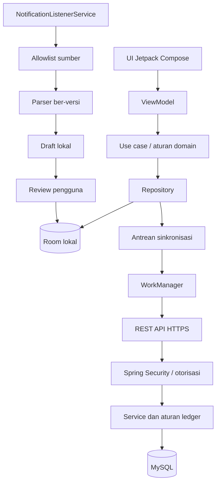

# Architecture.md — Arsitektur FinTrack

## 1. Prinsip arsitektur

- **Offline-first:** Room menjadi sumber pembacaan UI dan tempat tulis pertama.
- **Ledger-based:** saldo berasal dari saldo awal dan histori transaksi yang berlaku.
- **Review-required:** kandidat notifikasi selalu menjadi draft sebelum diposting.
- **Sync idempoten:** retry tidak membuat duplikasi dan data lokal tidak dihapus setelah sync.
- **Secure by design:** verifikasi identitas, otorisasi per pengguna, enkripsi transport, minimisasi data sensitif.

## 2. Stack

### Android
Kotlin, Jetpack Compose, Material 3, minimum API 26, ViewModel, coroutines/Flow, Room + SQLite, DataStore, WorkManager, Retrofit/OkHttp, Credential Manager/alur Google Sign-In yang didukung, Android Keystore, BiometricPrompt, `NotificationListenerService`, dan SQLCipher atau solusi setara yang kompatibel dengan Room setelah proof of concept.

### Backend
Java 21, Spring Boot 3.5.x, Spring Security, Spring Data JPA/Hibernate, Bean Validation, MySQL, Flyway, Maven Wrapper, Springdoc OpenAPI, JUnit 5, Spring Boot Test, MockMvc, serta Testcontainers bila lingkungan mendukung.

Pilih patch Spring Boot 3.5.x saat scaffold berdasarkan patch yang tersedia dan kompatibilitas dependency. Pastikan dukungan dan kompatibilitas API 26 sebelum menetapkan versi final. Jangan mengunci versi patch berdasarkan contoh yang belum diverifikasi.

### Lingkungan
Tahap pertama menjalankan Spring Boot dan MySQL langsung di laptop. Docker Compose bukan keharusan untuk tahap ini, tetapi boleh ditambahkan jika membantu reproduksibilitas. VPS digunakan setelah HTTPS, secret, backup/restore, akses database, dan pengujian otorisasi siap.

## 3. Gambaran aliran data



## 4. Struktur repository yang disarankan

```text
FinTrack/
├── PRD.md
├── Agents.md
├── Architecture.md
├── TODO.md
├── Skill.md
├── Workflow.md
├── StyleGuide.md
├── android/app/ dan android/gradle/
├── backend/src/main/java/...
├── backend/src/main/resources/db/migration/
├── backend/src/test/java/...
└── docs/adr/
```

Sesuaikan layout berdasarkan scaffold yang benar-benar dibuat, kemudian perbarui dokumen. Jangan commit database lokal, file ekspor finansial, keystore, secret, atau output build.

## 5. Modul Android

- `core/model`: model domain/value object.
- `core/database`: Room entity, DAO, converter, migrasi.
- `core/network`: Retrofit API, serialisasi, pemetaan error.
- `core/security`: token, app lock, helper kriptografi.
- `core/sync`: outbox, retry, cursor, konflik.
- `core/notifications`: listener, allowlist, parser, deduplikasi.
- `feature/auth`: login dan setup.
- `feature/dashboard`: ringkasan.
- `feature/accounts`: rekening dan rekonsiliasi.
- `feature/transactions`: daftar, detail, input manual.
- `feature/review`: kotak masuk draft.
- `feature/budgets`: budget dan target menabung (P1).
- `feature/settings`: izin, tema, keamanan, sync, ekspor.

Mulai dari batas package; jangan memecah banyak Gradle module sebelum ada manfaat nyata.

## 6. Modul backend

- `config`: konfigurasi keamanan, JSON, OpenAPI.
- `auth`: verifikasi token Google dan sesi aplikasi.
- `user`: profil dan siklus hidup user.
- `account`: rekening dan saldo awal.
- `ledger`: transaksi, transfer, adjustment, kategori, kalkulasi.
- `sync`: push/pull, idempotensi, versi dan konflik.
- `analytics`: agregasi jika kelak diperlukan di server.
- `common`: error response, validasi, ID/waktu.

Controller mengelola HTTP/DTO; service/domain menegakkan aturan; repository/query membatasi data menurut principal terautentikasi.

## 7. Model domain

### `User`
`id`, `google_subject` unik dari identitas Google yang telah diverifikasi, `email`, `created_at`, `updated_at`, `status`. Email tidak menjadi satu-satunya identitas permanen.

### `FinancialAccount`
`id`, `client_id`, `user_id`, `name`, `type` (`CASH`, `BANK`, `E_WALLET`, `OTHER`), `currency_code`, `opening_balance_minor`, `opening_balance_date`, `archived_at`, timestamps, `version`.

### `Category`
`id`, `user_id` (nullable hanya bagi kategori sistem jika dipilih), `name`, `kind` (`INCOME`/`EXPENSE`), icon/color key opsional, `archived_at`, timestamps. Kategori yang diarsipkan tetap dapat direferensikan transaksi historis.

### `Transaction`
`id`, `client_id`, `user_id`, `account_id`, `type` (`INCOME`, `EXPENSE`, `ADJUSTMENT`), `amount_minor`, `currency_code`, `occurred_at`, `local_date`, `category_id` opsional, `description`, `note`, `source` (`MANUAL`, `NOTIFICATION`, `IMPORT`, `RECONCILIATION`), `source_reference` minimum, `status` (`POSTED`, `VOIDED`), timestamps, `version`, dan `deleted_at` bila memakai soft delete.

Gunakan nominal absolut dengan tipe yang menentukan efek income/expense. Untuk adjustment, pilih nominal bertanda atau field arah khusus dan terapkan konsisten di Android/backend. Jangan gunakan floating point.

### `Transfer`
`id`, `client_id`, `user_id`, `source_account_id`, `destination_account_id`, `amount_minor`, `fee_minor`, `currency_code`, `occurred_at`, `description`, `status`, timestamps, `version`.

Transfer adalah satu operasi logis dengan dua efek ledger tertaut: rekening sumber berkurang dan rekening tujuan bertambah sebesar pokok transfer. Fee dicatat terpisah sebagai expense. Rekening sumber dan tujuan tidak boleh sama. Jika notifikasi hanya menangkap satu sisi, draft tidak mengubah saldo sebagai transfer lengkap sampai pengguna menyelesaikannya.

### `TransactionDraft`
Draft lokal: `id`, `source_app_id`, `parser_id`, `parser_version`, kandidat tipe/nominal/mata uang/waktu/rekening/kategori/deskripsi, `status` (`NEEDS_REVIEW`, `CONFIRMED`, `REJECTED`, `UNPARSED`), `dedupe_key`, `created_at`, `reviewed_at`. Raw notification body tidak disimpan secara default.

### `SyncOperation`
`id`, `entity_type`, `entity_client_id`, `operation_type`, `payload_version`, `idempotency_key`, `status` (`PENDING`, `IN_FLIGHT`, `SYNCED`, `RETRY`, `CONFLICT`, `FAILED`), `attempt_count`, `next_attempt_at`, `last_error_code` yang disanitasi, timestamps. Perubahan domain dan outbox ditulis atomik di Room.

### `Budget`/`SavingGoal` (P1)
Simpan nilai integer, periode, status, dan timestamp. Target menabung tidak sama dengan saldo rekening.

## 8. Invariant saldo

1. Saldo berasal dari saldo awal dan efek ledger aktif.
2. Pemasukan menambah saldo; pengeluaran mengurangi saldo.
3. Transfer mengurangi rekening sumber dan menambah rekening tujuan dengan pokok yang sama.
4. Fee adalah expense terpisah.
5. Transfer tidak dihitung sebagai income/expense pada analitik.
6. Rekonsiliasi mencatat adjustment bertanggal dan alasan.
7. Entri void tidak memengaruhi saldo; riwayat koreksi dipertahankan bila memungkinkan.
8. Jangan memakai cache saldo sebagai satu-satunya sumber kebenaran.
9. Gunakan satuan uang presisi dan aturan pembulatan eksplisit.

## 9. Pipeline notifikasi

1. Listener menerima event dan membaca field minimum.
2. Cocokkan sumber dengan allowlist.
3. Jalankan parser yang sesuai dan ber-versi.
4. Validasi nominal, mata uang, tanggal, serta petunjuk rekening.
5. Deduplikasi menggunakan kombinasi field yang relevan; jangan mengasumsikan satu teks selalu unik.
6. Simpan draft lokal.
7. Tampilkan draft di inbox review.
8. Pengguna mengedit, mengonfirmasi, atau menolak.
9. Hanya draft terkonfirmasi masuk ledger dan outbox.

Jika parsing tidak pasti, simpan draft tidak lengkap/status `UNPARSED`; jangan menebak nilai. Listener tidak digunakan sebagai polling service atau alasan mempertahankan wake lock.

## 10. Sinkronisasi offline-first

### Jalur tulis
1. Perubahan domain dan operasi outbox ditulis atomik ke Room.
2. UI langsung membaca perubahan lokal.
3. WorkManager menjalankan sync ketika jaringan tersedia.
4. Request membawa client ID stabil dan idempotency key.
5. Backend memvalidasi ownership lalu menyimpan secara idempoten.
6. Aplikasi menandai operasi outbox selesai berdasarkan respons server.
7. Record transaksi lokal tetap dipertahankan.

### Konflik dan retry
Gunakan optimistic versioning dan konflik eksplisit. Jangan membuang perubahan lokal ketika request gagal atau menimpa versi lebih baru secara diam-diam. Bedakan error yang dapat di-retry dengan error validasi/otorisasi; gunakan retry berbatas dengan backoff.

## 11. Usulan API awal

| Method | Endpoint | Tujuan |
|---|---|---|
| `POST` | `/api/v1/auth/google` | Validasi identity token Google dan mulai sesi |
| `POST` | `/api/v1/auth/refresh` | Refresh sesi jika strategi tersebut dipakai |
| `POST` | `/api/v1/auth/logout` | Mencabut sesi/refresh token bila didukung |
| `GET` | `/api/v1/me` | Profil pengguna aktif |
| `GET/POST` | `/api/v1/accounts` | Daftar/buat rekening |
| `GET/PATCH` | `/api/v1/accounts/{id}` | Baca/ubah metadata rekening |
| `GET/POST` | `/api/v1/transactions` | Daftar/buat transaksi |
| `GET/PATCH` | `/api/v1/transactions/{id}` | Baca/ubah transaksi |
| `POST` | `/api/v1/transfers` | Membuat transfer logis secara atomik |
| `GET/POST` | `/api/v1/categories` | Daftar/buat kategori |
| `POST` | `/api/v1/sync/push` | Mengirim perubahan lokal secara idempoten |
| `GET` | `/api/v1/sync/pull` | Mengambil perubahan berdasarkan cursor/version |
| `GET` | `/api/v1/health` | Health status non-sensitif |

Kontrak final wajib mendokumentasikan auth, DTO, uang, timestamp, pagination, error, idempotency, dan konflik. Pengguna harus ditentukan dari principal, bukan `userId` di payload.

## 12. Autentikasi dan keamanan

- Backend memvalidasi signature, issuer, audience, expiry, dan klaim wajib token Google menggunakan mekanisme resmi.
- Tetapkan expiry access JWT, refresh/revocation, rotasi kunci, issuer, dan audience.
- Lindungi token melalui penyimpanan yang memanfaatkan Android Keystore.
- Wajib HTTPS saat deployment. Konfigurasi HTTP lokal tidak boleh masuk build release.
- Uji akses silang pengguna untuk seluruh endpoint privat.
- Uji SQLCipher/solusi setara, termasuk pembukaan DB tanpa kunci, rotasi/migrasi dan dampak kehilangan kunci. Jangan hardcode kunci.
- PIN/biometrik melindungi akses UI, bukan pengganti auth API atau enkripsi DB.
- Dokumentasikan backup, retensi, kehilangan kunci, sign-out, dan penghapusan data.

## 13. Strategi test

**Android:** unit test uang/saldo/transfer/parser/dedupe/sync; Room DAO/migration; ViewModel states; tes inisialisasi database terenkripsi; uji notifikasi pada perangkat nyata.

**Backend:** unit test ledger; integration test persistence/migration/idempotensi; test unauthenticated dan cross-user; kontrak API; replay request.

**End-to-end:** setup rekening → input manual → draft notifikasi → review → transfer → offline → sync → verifikasi data tetap lokal → ekspor/pemulihan.

## 14. Architecture Decision Records (ADR)

Seluruh keputusan arsitektur awal telah didokumentasikan di direktori `docs/adr/` dengan format standar (lihat [template](docs/adr/template.md) dan [indeks ADR](docs/adr/README.md)):

- [ADR-001 Offline-first dan sync outbox](docs/adr/ADR-001-offline-first-sync-outbox.md)
- [ADR-002 Draft notifikasi wajib direview](docs/adr/ADR-002-draft-notifikasi-review.md)
- [ADR-003 Transfer dengan dua efek ledger](docs/adr/ADR-003-transfer-dua-efek-ledger.md)
- [ADR-004 Google verification dan siklus JWT](docs/adr/ADR-004-google-verification-jwt.md)
- [ADR-005 Enkripsi lokal dan key lifecycle](docs/adr/ADR-005-enkripsi-lokal-key-lifecycle.md)
- [ADR-006 Idempotensi dan konflik sync](docs/adr/ADR-006-idempotensi-sync-conflict.md)
- [ADR-007 Backend lokal langsung di laptop](docs/adr/ADR-007-backend-lokal-laptop.md)
- [ADR-008 Allowlist dan sumber notifikasi pertama](docs/adr/ADR-008-allowlist-sumber-notifikasi.md)
- [ADR-009 Neobrutalism dan Sora](docs/adr/ADR-009-neobrutalism-dan-sora.md)

